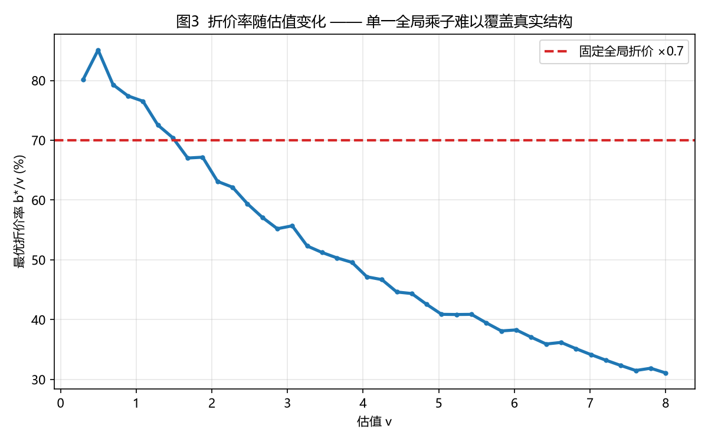
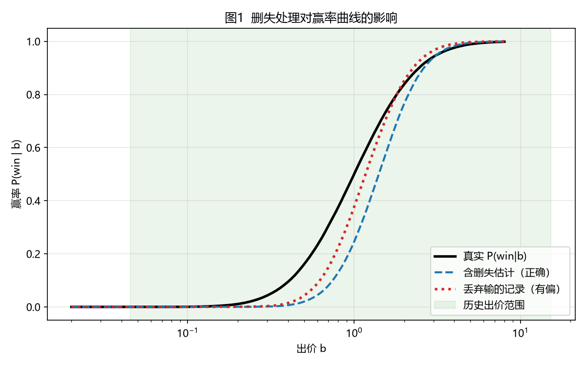
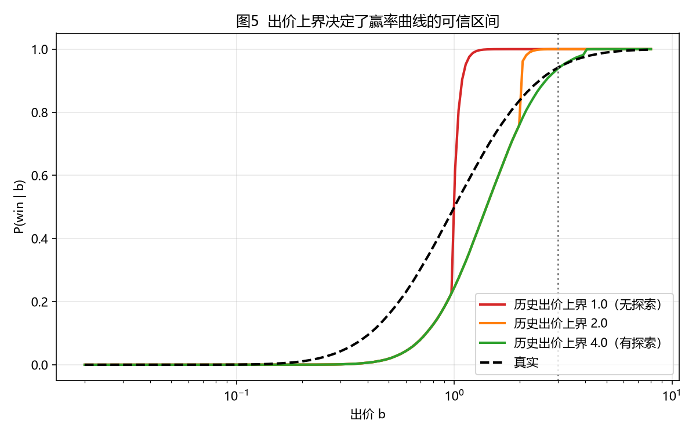
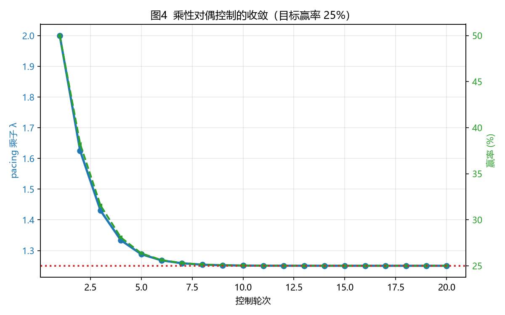

# DSP 竞价应对策略调研：算法方向、工业实践与落地路径

> **技术调研报告（v1）** ｜ 2026-10-30 ｜ 对象：广告主（买方）在 DSP 竞价中的应对与反馈调整
> 覆盖问题：广告主如何根据当前竞价场景制定有效竞价策略；如何根据竞价反馈动态调整；是否存在算法化方案；工业界与研究界的现状。
> 定位：与 [DSP-2026-10-26](../2026-10-26/00-dsp-bidding-algorithms.md)（出价算法与预算分配）、[RTB 买入侧全链路](../2026-10-26/05-rtb-buy-side-survey.md) 并列。前两篇回答"工业界在用什么"，本篇回答"**广告主明天能落地什么**"：把最优条件推导到可执行程度，并附可复现的最小实现。
> 方法：arXiv 文献逐条核对（每条引用附原始链接，核实状态见第十一章）＋ 五个小规模确定性仿真（固定随机种子，代码随文发布）。
> **配套代码**：[bid_strategy_toolkit.py](assets/bid_strategy_toolkit.py)（仅依赖 numpy，`python bid_strategy_toolkit.py` 即可复现全部数值）· [make_figures.py](assets/make_figures.py)

---

## 摘要

广告主侧的竞价决策早已不是"只能人工观察调整"的经验活。经过近十年发展，它已经形成一条**估值 → 折价 → 反馈控制**的完整算法流水线，并在美团、阿里、快手、Walmart、Yahoo 等生产系统中大规模运行。

本报告给出四条核心结论：

1. **竞价是一个有闭式最优条件的一维优化问题**。每次竞价求解 $\max_b (v-b)P(\text{win}\mid b)$，其最优解满足勒纳条件 $\frac{v-b^*}{b^*}=\frac{1}{\varepsilon(b^*)}$。这意味着"出到最可能成交价"是次优的，必须对低价值曝光大幅折价。本报告配套代码逐点验证了该条件（实验 2）。

2. **竞价反馈的核心难点是数据删失，不是模型选择**。输掉的竞价只提供"胜出价 > 我的出价"这一右删失信息。丢弃这些记录会造成系统性偏差——本报告数值实验显示，低价位赢率被高估、曲线形状被压平（实验 1、图 1）。处理方式是生存分析似然 / 风险率表。

3. **闭环控制比离线最优化更重要**。离线原始-对偶最优解在线不可达，真实系统的鲁棒性来自分钟级的反馈控制器（Alibaba KDD'19 的核心贡献）。乘性对偶更新 $\lambda \leftarrow \lambda e^{\eta e_t}$ 在 6–8 轮内收敛，且理论上对策略性对手不可操纵（Fikioris 等 2026）。

4. **人工调整不会消失，但角色变了**。人工应负责设定目标与约束、处理结构性冲击（大促、新品、渠道重排）、守住政策底线。逐次改价格应由算法接管。

---

## 目录

1. [问题界定与分析框架](#一问题界定与分析框架)
2. [核心数学：竞价的最优条件](#二核心数学竞价的最优条件)
3. [竞价反馈：删失数据与赢率估计](#三竞价反馈删失数据与赢率估计)
4. [折价算法：从两阶段到时序生成](#四折价算法从两阶段到时序生成)
5. [预算与 ROI：对偶变量与 pacing 控制](#五预算与-roi对偶变量与-pacing-控制)
6. [跨渠道分配与场景自适应](#六跨渠道分配与场景自适应)
7. [竞争与对抗：市场层面的约束](#七竞争与对抗市场层面的约束)
8. [工业应用全景](#八工业应用全景)
9. [人工 vs 算法：边界在哪里](#九人工-vs-算法边界在哪里)
10. [落地路径](#十落地路径)
11. [文献可信度说明](#十一文献可信度说明)
12. [附录：代码与实验](#附录代码与实验)

---

## 一、问题界定与分析框架

### 1.1 广告主在竞价链路中的位置

```
用户访问 → SSP 发起请求 → AdX 组织竞价
                              ↓
                    ┌─────────────────┐
                    │   DSP（代广告主）  │
                    │  ├ 召回/筛选      │
                    │  ├ CTR/CVR 预估   │  ← 估值层
                    │  ├ 出价计算       │  ← 定价层（本报告重点）
                    │  └ 预算/ROI 控制  │  ← 控制层
                    └─────────────────┘
                              ↓
                    出价 b 参与竞价
                              ↓
              ┌──────────────┴──────────────┐
          赢：支付成交价              输：只知道"胜出价 > b"
              └──────────────┬──────────────┘
                              ↓
                        写回日志 → 下一轮反馈
```

广告主的可控杠杆只有三个：**出价高低**、**预算分配**、**目标设定**（CPA / ROI / 量级）。本报告聚焦前两个如何算法化。

### 1.2 四层架构

| 层 | 决策对象 | 时间尺度 | 主要方法 | 本报告章节 |
|---|---|---|---|---|
| 估值层 | 曝光值多少钱 $v$ | 离线训练、在线推理 | pCTR×pCVR×用户价值 | 不展开 |
| 定价层 | 出价 $b$ 相对 $v$ 的折价率 | 单次竞价（毫秒级） | 赢率/成交价分布 + 盈余最大化 | 第二、三、四章 |
| 控制层 | 预算与 ROI/CPA 目标的达成 | 分钟到小时 | 对偶变量 / PID 控制器 | 第五章 |
| 策略选择层 | 不同场景用哪套策略 | 小时到天 | 上下文 Bandit / RL | 第六章 |

分层的意义在于**解耦**：估值模型有误差时，定价层和控制器仍能维持系统稳定。第 1.3 节会说明为什么耦合会导致灾难。

### 1.3 一个常见误区：把约束塞进定价层

很多团队的做法是"设一个全局折价乘子 $\rho$，然后手动调到 ROI 达标"。这在结构上就把**约束满足**和**资源分配**两件事混在了一起。

正确的做法是：

- **定价层**只回答"给定 $v$，出多少使这条曝光的盈余最大"——这是纯弹性问题，与预算无关
- **控制层**用 $\lambda$ 统一缩放所有出价，负责让总花费/ROI 落到目标——这是纯优化问题，与单条曝光的估值无关

合并后的形式是 $b_i = \lambda \cdot b^*(v_i)$。Alibaba KDD'19、Balseiro 等人的对偶理论、Fikioris 等人的控制器分析，都建立在这个分解之上。

---

## 二、核心数学：竞价的最优条件

### 2.1 目标函数

对每次竞价请求，设：

- $v$ —— 这条曝光的估值（期望转化价值）
- $b$ —— 出价
- $c(b)$ —— 赢下时的实际支付（一价 $c\approx b$；二价 $c=E[z \mid z<b]$）
- $F(b) = P(z < b)$ —— 出价 $b$ 时的赢率，$z$ 为最高竞争出价

期望盈余：

$$S(b) = \bigl(v - c(b)\bigr)\cdot F(b)$$

### 2.2 一阶条件与勒纳条件

一价下 $c(b)=b$，一阶条件：

$$F(b) + (v-b)F'(b) = 0
\quad\Longrightarrow\quad
\frac{v-b^*}{b^*} = \frac{1}{\varepsilon(b^*)},
\quad \varepsilon(b)=\frac{d\ln F}{d\ln b}$$

这是**勒纳指数条件**在竞价中的形式：相对利润率应等于赢率弹性的倒数。直觉是——

- 当市场中"和你出价接近的竞争者很多"（弹性高）时，略微降价损失不了多少赢率，**应该降价**
- 当"你离下一个竞争者很远"（弹性低）时，降价会显著损失曝光，**应该加价**

### 2.3 风险率形式

令 $H(z) = f(z)/\bar{F}(z)$ 为竞争出价的风险率，最优解可写成：

$$\frac{b^*}{v} = \frac{1}{1 + b^* H(b^*)}$$

$H$ 越大（在 $b$ 附近竞争者密集）→ 折价越狠。这个形式在现场很有用：它把"市场拥挤程度"变成了一个可读的数值指标。

### 2.4 数值验证

配套代码实验 2 在一条模拟的 landscape 上验证勒纳条件：

| 估值 $v$ | 最优出价 $b^*$ | 折价率 $b^*/v$ | 赢率 | 弹性 $\varepsilon$ | $(v-b)/b$ | $1/\varepsilon$ |
|---|---|---|---|---|---|---|
| 0.50 | 0.423 | 84.7% | 0.9% | 5.28 | 0.18 | 0.19 |
| 1.00 | 0.773 | 77.3% | 11.5% | 3.40 | 0.29 | 0.29 |
| 2.00 | 1.311 | 65.5% | 44.3% | 1.78 | 0.53 | 0.56 |
| 4.00 | 1.911 | 47.8% | 73.6% | 0.92 | 1.09 | 1.09 |
| 8.00 | 2.488 | 31.1% | 87.9% | 0.46 | 2.22 | 2.17 |

后两列完全吻合，说明实现正确。

**关键观察**：折价率从 84.7% 一路降到 31.1%，**它是估值的函数，不是常数**。这就是固定全局乘子（图为 0.7）在结构上不足的原因（图 3）。



### 2.5 为什么不能"出成交价中位数"

一个非常常见的启发式是：观察历史成交价，出其中位数。实验 3 显示，在同一个 landscape 上：

| 策略 | 平均出价 | 赢率 | 总花费 | 总盈余 | ROI |
|---|---|---|---|---|---|
| 出真实价值 $v=1.0$（不折价） | 1.000 | 50.0% | 99,972 | **0** | 1.000 |
| 出成交价中位数（观察者偏差） | 1.173 | 59.0% | 138,381 | **−20,395** | 0.853 |
| 单一全局折价 ×0.7 | 0.700 | 30.5% | 42,669 | 18,287 | 1.429 |
| 盈余最大化 $b^*(v)$ | 0.773 | 35.6% | 55,067 | 16,127 | 1.293 |

"出成交价中位数"**亏钱**。原因有两层：一是观察者偏差（你只看到自己赢下的价格，中位数被你自己偏低的出价锚定后又被重估抬高）；二是它完全忽略了利润项，属于"零盈余"策略。

而盈余最大化策略在更低的 ROI（1.29 vs 1.43）下取得了可观的绝对盈余——这正是它应该被上层控制器统一缩放的原因，而不是被一次调死。

---

## 三、竞价反馈：删失数据与赢率估计

### 3.1 你能拿到的三类反馈

| 反馈类型 | 信息量 | 典型来源 |
|---|---|---|
| 赢/输（二元） | 仅知"胜出价 > 我的出价" | 最普遍 |
| 胜出价 | 输时给下界，赢时给精确值 | 部分 SSP / AdX |
| 最低赢价、出价建议 | 完整 landscape | 部分 PMP / 一价时代的 Google |

**信息量决定了你能做多精细的策略。** 只有二元反馈时，你仍然可以做完整的折价——但必须用删失似然。

### 3.2 删失：整个领域的核心数据问题

赢下时你观察到 $z<b$；输掉时只观察到 $z>b$。这是**右删失（right-censoring）**，与生物统计里的生存数据同构。

**错误做法**：只保留赢的记录，直接拟合 $P(\text{win}\mid b)$。这等价于在似然里删掉了所有删失项，结果是对赢率曲线的系统性扭曲。

**正确做法**：把每个价格档的条件风险率作为参数：

$$\lambda_k = P(z \text{ 落在档 } k \mid z \ge q_k)$$

似然为：

$$\mathcal{L}=\underbrace{\prod_{i:\,\text{win}}\lambda_{k_i}\prod_{j<k_i}(1-\lambda_j)}_{\text{赢：精确位置已知}}\cdot\underbrace{\prod_{i:\,\text{lose}}\prod_{j\le k_i}(1-\lambda_j)}_{\text{输：只知道在右侧}}$$

最终赢率 $F(b)=1-\prod_{j\le k(b)}(1-\lambda_j)$。这就是 Kaplan–Meier 加出价阈值协变量。

### 3.3 数值实验

实验 1 的结果（20 万条模拟竞价，历史出价范围 0.045–15.26）：

| 出价 $b$ | 真实 P(win) | 含删失估计 | 丢弃输的记录 |
|---|---|---|---|
| 0.30 | 4.3% | 0.1% | 0.3% |
| 0.50 | 16.0% | 2.0% | 4.3% |
| 0.80 | 37.4% | 12.9% | 22.3% |
| 1.20 | 60.3% | 37.4% | 51.8% |
| 2.00 | 83.9% | 76.5% | 85.2% |
| 3.00 | 94.2% | 94.0% | 96.6% |



丢弃输的记录后，曲线在低价位**严重高估**、在高价位低估，形状被压平。图 1 中正确的曲线与真实曲线高度贴合，偏移主要出现在出价分布稀疏的尾部——这是 KM 估计在小样本区间的固有性质，可用更细网格或平滑/保序回归改善。

**实践含义**：如果你曾用"只导出赢的竞价"的数据做过分析，几乎所有结论都需要重做。

### 3.4 样本选择偏差与探索预算

即使正确处理了删失，还有一个问题：你只观察到低于自己出价的成交价。超过历史出价上界的部分，完全是外推。

实验 5 展示了后果：当历史出价上界为 1.0 或 2.0 时，对 $b=3.0$ 的赢率估计会饱和到 100%，而真实值是 94.2%。



**解决方案**：把 1–5% 的流量用于**随机化出价**（如乘一个 $U[0.8, 2.0]$ 的乘子），把观测范围主动推向高价区。这笔成本应记作"学习投入"，不是"浪费"。这也是 GBS 等系统里"探索效用奖励"要解决的问题。

### 3.5 文献脉络

| 工作 | 年份/会议 | 方法要点 | 是否上线 |
|---|---|---|---|
| 无分布/参数化 landscape | 早期多篇 | 假设成交价服从正态/对数正态/Gamma | 研究 |
| [Deep Landscape Forecasting (Ren 等)](https://arxiv.org/abs/1905.03028) | KDD 2019 | 沿价格轴 RNN，链式法则处理删失，无需分布先验 | 研究（开源） |
| [Scalable Bid Landscape Forecasting (Ghosh 等)](https://arxiv.org/abs/2001.06587) | ECML-PKDD 2019 | 异方差删失回归 + 混合密度网络 | 是，大型 DSP |
| [Deep Distribution Network (Zhou 等)](https://arxiv.org/abs/2107.06650) | KDD 2021 | 深度分布网络，区分开放/删失竞价 | 是，Verizon Media DSP |
| [Arbitrary Distribution Modeling (Li 等)](https://arxiv.org/abs/2110.13587) | 2021 preprint | 邻域似然损失，任意分布 + 删失 | 是，生产数据回放 |
| [Market Segmentation Trees](https://arxiv.org/abs/1906.01174) | 2019 / MSOM | 可解释分群 + 保序回归树做 landscape | 研究（开源） |

---

## 四、折价算法：从两阶段到时序生成

### 4.1 三条技术路线

**(a) 两阶段：先估 landscape，再运筹优化。** 主流基线。第一步估计 $F(b)$，第二步在 $b$ 上做一维搜索（二分、黄金分割）最大化 $S(b)$。

- 优点：模块清晰、可解释
- 缺点：两阶段误差级联；多数实现假设 $S(b)$ 单峰

**(b) 直接回归折价率。** 跳过显式分布，直接训练模型输出 $\rho = b^*/v$。
- 代表：[Gligorijevic 等, CIKM 2020](https://arxiv.org/abs/2009.01360)
- 缺点：需要最优折价率作为标签，而标签本身来自某个（可能错误的）估计器

**(c) 直接回归赢率函数。** 用参数化/半参数形式拟合 $F(b)$，再闭式或快速求最优。
- 代表：[Pan 等, AdKDD 2020](https://arxiv.org/abs/2009.09259)——对数几率形式，运行时闭式求解，**不依赖 SSP 回传最低赢价**
- 实测：价格约为不打折时的 55%，相对"出成交价"策略盈利 +7%

### 4.2 当前前沿：生成式折价

[Generative Bid Shading（GBS），美团，SIGIR 2026](https://arxiv.org/abs/2508.06550) 是目前该方向最完整的工业工作。它明确指出现有两阶段的三个缺陷：

1. **单峰假设不成立**——真实盈余曲线非凸，可能多峰，搜索会陷入局部最优（论文图 2 给出美团非理想二价数据的实证）
2. **误差级联**——第一阶段估计误差被第二阶段放大
3. **离散化忽略区间依赖**——把连续值切桶当独立分类，丧失纠错能力

GBS 的做法：

- **自回归生成折价率**：把 $\rho$ 分解为单调递减的 token 序列（残差表示），逐步精化，不依赖预设先验
- **奖励偏好对齐**：用 CHNet 作为奖励模型，配合 GRPO 优化"短期 + 长期盈余"
- **双奖励机制**：盈余优化对齐 + 探索效用对齐（对治样本选择偏差）

效果：离线 + 在线 A/B 均优于 SOTA，**部署在美团 DSP，日服务数十亿次竞价请求**。

### 4.3 鲁棒性版本：当你不信任自己的估计

插件最优（plug-in optimum）在估计有噪时会系统性过度激进。对此有两类修正：

- [Double Distributionally Robust Bid Shading (Qu 等, 2024)](https://arxiv.org/abs/2410.14864)——对价值和竞争 landscape 各设一个 KL 模糊集做 max-min，在 Yahoo DSP 真实数据上优于非鲁棒版本
- [Prior-Independent Bidding (Kumar & Mouchtaki, 2025)](https://arxiv.org/abs/2502.09907)——极小极大后悔的折价策略，不依赖任何分布假设

**建议**：数据充分的产品线上插件最优；长尾分桶、新市场、冷启动用鲁棒版本。

### 4.4 多坑位与多价

- 列表页多坑位：[MEBS (2024)](https://arxiv.org/abs/2403.02607)，阿里/淘宝，GMV +7.01%、ROI +7.42%
- 非一价/多价：[HOB (2025)](https://arxiv.org/abs/2510.15238)，零膨胀指数分布建模 + 跨渠道边际成本拉平，GMV +3.0%

---

## 五、预算与 ROI：对偶变量与 pacing 控制

### 5.1 为什么必须要控制器

Alibaba KDD'19 的核心论断：**离线的原始-对偶最优解在线不可达**。原因是 landscape 是时变的、竞争者会反应、反馈有延迟。因此系统的鲁棒性来自闭环，而非离线的精确求解。

[Xu 等, KDD 2015](https://arxiv.org/abs/1506.05851) 更早地给出了 pacing 控制器在动态 landscape 下的学习框架。

### 5.2 标准控制律

```
bid_i = pCTR_i × target_CPA × λ          # CPA 目标
bid_i = pValue_i / target_ROI × λ        # ROI 目标

# 乘性对偶更新（推荐）
log λ_{t+1} = log λ_t + η · e_t

# CPA 模式: e_t = (CPA_t − target_CPA) / target_CPA
# ROI 模式: e_t = (target_ROI − ROI_t) / target_ROI
λ_{t+1} = clip(λ_t · exp(η·e_t), λ_min, λ_max)
```

**为什么用乘性而非加性**：

- 尺度无关（10% 超标在任意预算量级下含义一致）
- 天然非负（加性对偶下降可能卡在 0 不动）
- 正是 [Balseiro–Lu–Mirrokni 对偶镜像下降](https://arxiv.org/abs/2011.10124) 的理论形式

### 5.3 数值实验：收敛性

实验 4 从错误的 $\lambda=2.0$ 出发，目标赢率 25%：

| 轮次 | 1 | 2 | 3 | 4 | 5 | 6 | 7 | 8 |
|---|---|---|---|---|---|---|---|---|
| $\lambda$ | 2.000 | 1.625 | 1.430 | 1.334 | 1.288 | 1.268 | 1.259 | 1.254 |
| 实际赢率 | 50.0% | 38.2% | 31.6% | 28.1% | 26.4% | 25.6% | 25.3% | 25.1% |
| 误差 (pp) | +25.0 | +13.2 | +6.6 | +3.1 | +1.4 | +0.6 | +0.3 | +0.1 |



约 6–8 轮收敛，无过冲。这直观解释了为什么控制理论方法在实际系统中如此耐用。

### 5.4 分层控制：KPI 环与预算环

两个约束需要两个乘子，**取 min 而非乘积**：

```
p_t = (剩余预算 / 总预算) / (剩余时间 / 总时长)
λ_budget ← λ_budget · exp(η_b · (1 − p_t))
λ_effective = min(λ_KPI, λ_budget)
```

用 min 的原因：预算耗尽时，激进的 KPI 乘子不该"补偿"回来，否则会超支。

### 5.5 实际中的四个失效点

| 失效点 | 现象 | 对策 |
|---|---|---|
| **反馈延迟** | 信号晚 5 分钟到 1 天，控制器对已发生的行为反应 | $\eta \le 0.1/\text{延迟步数}$；更新频率 ≤ 延迟一半；按已过时间归一化 |
| **转化回传延迟** | 日内早期 CPA 偏高、晚期偏低 | 用经验回传曲线做生存校正；快环只控花费，慢环控 CPA |
| **反馈停滞** | 低出价 → 几乎不出曝 → 零反馈 | 保留探针出价与 $\lambda$ 下限；薄流量时加探索地板 |
| **非平稳 / 竞争互动** | 映射关系漂移 | 用相对误差；A/B 留出独立验证单元；不用调参窗口评估效果 |

### 5.6 理论支撑

| 工作 | 年份/会议 | 贡献 |
|---|---|---|
| [Balseiro & Gur](https://doi.org/10.1287/mnsc.2018.3174) | Mgmt Sci 2019 | 预算约束重复竞价的遗憾界与均衡；为 pacing 乘子提供理论许可 |
| [Dual Mirror Descent (Balseiro 等)](https://arxiv.org/abs/2011.10124) | 2020 | 无凸性假设下渐近最优；乘性/加性更新的统一框架 |
| [Pacing Equilibrium (Conitzer 等)](https://doi.org/10.1287/mnsc.2022.4310) | Mgmt Sci 2022 | 一价市场中 pacing 均衡必定存在 |
| [Lucier 等](https://arxiv.org/abs/2301.13306) | COLT 2024 | 预算+ROI 双约束，流动福利 ≥ 最优的 1/2，**是否收敛到均衡都成立** |
| [Fikioris, Sivan, Tardos](https://arxiv.org/abs/2604.08517) | 2026 | **比例（P）控制器可证明不被策略性对手操纵** |

---

## 六、跨渠道分配与场景自适应

### 6.1 跨渠道：调预算，不要调 ROI 目标

[Deng 等, ICML 2023](https://arxiv.org/abs/2302.01523) 的核心结论对实操极其重要：

> 广告主在多渠道购买时，只能设置**各渠道预算**和**各渠道目标 ROI**。
> 只优化各渠道 ROI 目标，结果可能**任意差于全局最优**；
> 只优化各渠道预算，可以**达到全局最优**。

**操作建议**：跨渠道时固定各渠道 ROI 目标（作为约束），主要调预算分配；分配用 bandit 学习。

配套理论：[Aggarwal 等 (2024)](https://arxiv.org/abs/2405.02699) 指出在多平台场景下，平台选择拍卖形式会受广告主敏感度影响，landscape 是内生的。

### 6.2 场景自适应：上下文选择

当"关键词 × 人群 × 设备 × 时段"各自的最优策略不同时，这是上下文 Bandit 问题。

- [Online Causal Inference (Waisman, Nair, Carrion)](https://arxiv.org/abs/1908.08600)——论证广告效应由最优出价识别，用适配 Thompson sampling 恢复最优出价，遗憾界阶数最优
- [Dual-LTE (Hu 等, 2026)](https://arxiv.org/abs/2605.09448)——同时学习印象增值与最高竞争出价，预算/RoS 约束下遗憾 $\tilde O(\sqrt T)$（全信息）/ $\tilde O(T^{2/3})$（赢输二元反馈）

**Dual-LTE 给出的操作性建议很关键**：只有当价值估计足够准确时才使用拉格朗日出价规则，否则应受控探索。这就是"bandit vs. exploit"的切换判据。

### 6.3 分群是一种低成本的场景自适应

[Walmart 的 offsite 系统](https://arxiv.org/abs/2306.10476)（KDD 2023 workshop）给出了一个很适合中等规模团队的模板：

1. 自动搜索广告请求空间的最优分群（地域、时间、版式、站点、设备）
2. 用收入信号评估各分群的质量
3. **在投放过程中迭代地重新近似 landscape**，计算各维度的出价调整
4. ROAS 高的维度提高乘子，反之降低

效果：ROAS 和转化率上升、eCPM 下降。

这与本报告第三、五章的框架完全兼容——分群就是把单一 $\lambda$ 扩展为向量 $\lambda_{\text{segment}}$。

---

## 七、竞争与对抗：市场层面的约束

### 7.1 "跟着对手出价"不是中性操作

[Banchio & Skrzypacz (2022)](https://arxiv.org/abs/2202.05947) 用 Q-learning 智能体做重复竞价实验，发现：

- 一价拍卖在缺乏额外反馈时，会收敛到**默契合谋**（出价低于估值）
- 二价拍卖不会
- 机制是"加一个最小增量即可超越对手"的激励，便于在实验阶段后重新协调到低价
- 提供"最低赢价"信息会提升竞争性

对本方的含义：**你看到的市场价格，本身是其他算法行为的产物**。压低出价"等市场降价"可能只是在参与一个低效均衡。

### 7.2 算法耦合与合规风险

[Banchio & Mantegazza (2022)](https://arxiv.org/abs/2202.05946) 提出"自发耦合（spontaneous coupling）"：即使没有通信，**仅仅共享估计噪声**（同一家三方工具、同一套行业基准数据、同一批特征）就能让独立的学习算法定期协同到高于纳什的利润水平。

**这不只是建模问题，是反垄断暴露**——对广告主和代运营方同样成立。风控要点：

- 避免完全依赖公开的"市场基准价"作为出价锚
- 代运营方同时服务多个互为竞争者的客户时，注意数据隔离
- 保留决策依据的可审计性

### 7.3 被操纵的风险与防御

Fikioris 等（2026）证明：策略性优化者**能**剥削学习者，但**不能**剥削使用比例（P）控制器的学习者。防御措施因此很具体：

1. 用标准控制理论 pacing，而非激进的端到端学习策略
2. 不要向单一对手暴露可预测的学习响应曲线

### 7.4 竞争态势下的工具矩阵

| 问题 | 处理方向 | 代表文献 |
|---|---|---|
| 赢率骤降、拿不到量 | 重估 landscape，判断是市场性涨价还是自身出价问题 | Ren KDD'19、Zhou KDD'21 |
| 能赢但利润低 | 做折价，解弹性条件 | Pan AdKDD'20、GBS |
| 预算提前烧完/烧不完 | 对偶变量 pacing | Balseiro & Gur、Conitzer 等 |
| CPA/ROI 漂移 | P/PI 反馈控制器 | Yang KDD'19、Fikioris 等 |
| 多平台分配 | 调预算而非 ROI 目标 | Deng ICML'23 |
| 分场景差异化 | 上下文 Bandit 选策略 | Waisman 等、Hu 等 |
| 对手算法可能针对你 | 用 P 控制器 + 降低可预测性 | Fikioris 等 |
| 对市场估计没把握 | 鲁棒/极小极大折价 | Qu 等、Kumar & Mouchtaki |
| 市场整体价格变动 | 参照 Goke 等的实证，理解学习期 | Goke 等 2021 |

---

## 八、工业应用全景

### 8.1 已上线系统

| 系统 / 机构 | 论文 | 做了什么 | 规模 / 效果 |
|---|---|---|---|
| **美团 DSP** | [GBS, SIGIR 2026](https://arxiv.org/abs/2508.06550) | 自回归生成折价 + GRPO 奖励对齐 | 日数十亿次竞价请求 |
| **阿里 / 淘宝** | [Yang 等, KDD 2019](https://arxiv.org/abs/1905.10928) | LP 原始-对偶导出最优出价 + 多变量反馈控制 | CPC 约束下最大化转化，淘宝真实流量 |
| **阿里 / 淘宝** | [MEBS, 2024](https://arxiv.org/abs/2403.02607) | 多坑位端到端折价 | GMV +7.01%，ROI +7.42% |
| **Yahoo / Verizon Media** | [Zhou 等, KDD 2021](https://arxiv.org/abs/2107.06650) | 深度分布网络折价 | 数百亿请求/日 |
| **Yahoo / Verizon Media** | [Pan 等, AdKDD 2020](https://arxiv.org/abs/2009.09259) | 对数几率赢率 + 闭式盈余最大 | 成本约 55%，盈利 +7% |
| **Walmart** | [Offsite 系统, KDD 2023 wksp](https://arxiv.org/abs/2306.10476) | 自动分群 + 迭代 landscape + 维度乘子 | ROAS/转化率上升，eCPM 下降 |
| **快手** | [PlatformBid, 2026](https://arxiv.org/abs/2607.27265) | 平台视角多智能体基准 + 流匹配出价（BidFlow） | 线上目标成本 +0.68% |
| **大型商业 DSP** | [HOB, 2025](https://arxiv.org/abs/2510.15238) | 跨渠道边际成本拉平 | GMV +3.0% |

### 8.2 公共基准与模拟器

- [AuctionNet (2024)](https://arxiv.org/abs/2412.10798)——阿里，1000 万曝光、48 个自动出价智能体、5 亿+ 竞价记录。NeurIPS 2024 竞赛底座。**可以拿来压测自己的策略，无需自建模拟器**。
- [PlatformBid (2026)](https://arxiv.org/abs/2607.27265)——快手，三种竞争态势（同质 / 异质 / 大促）。关键发现：**算法排名会随竞争态势改变**，单智能体训练的 bidder 在异质对手面前会退化。

### 8.3 一个重要的实证

[Goke 等 (2021)](https://arxiv.org/abs/2110.13814) 研究市场从二价转一价的过程：成交价先跳涨 **25–70%**，然后随广告主**学会折价**而逐步回落。

这说明：**市场均衡会漂移，应对速度本身就是竞争力**。在别人还在适应时先做了折价的广告主，获得了阶段性成本优势。

### 8.4 效果预期校准

为避免对收益有不合理期待，列出已发表的生产数据：

| 来源 | 指标 | 幅度 |
|---|---|---|
| Pan 等（折价本身） | 单位曝光成本 | 降至约 55% |
| Pan 等 | 相对"出成交价"盈利 | +7% |
| Zhou 等 | ROI（CPM/CPA 活动） | +2.4% / +8.6% |
| MEBS | GMV / ROI | +7.01% / +7.42% |
| HOB | GMV | +3.0% |
| BidFlow（快手） | 目标成本 | +0.68% |

**判断准则**：第一版若做出两位数百分比收益，先怀疑估值模型有泄漏或赢率崩溃，而不是算法太强。

---

## 九、人工 vs 算法：边界在哪里

### 9.1 算法应该接管的

- 逐次折价（定价层）
- 预算 pacing 与 ROI 控制（控制层）
- 关键词/人群/设备/时段的出价修正（上下文 Bandit）
- 跨渠道预算分配

### 9.2 人工应该保留的

| 场景 | 原因 |
|---|---|
| **结构性冲击**：大促、新品、渠道重排 | PlatformBid 的促销态势显示，手工预算常优于学习出的 pacing——冲击在算法看到之前你已经知道了 |
| **反馈稀疏或延迟严重** | 冷启动、小预算账户；bandit 学不到它看不到的东西 |
| **可能被针对** | 保持控制器简单（P 控制器）和反应慢 |
| **一次性高风险决策** | 年度框架、冠名，无重复学习机会 |
| **政策底线** | 品牌安全、毛利下限、合规版位上限，不应被模型学掉 |

### 9.3 推荐的分工

> **Bandit 决定"每个场景用哪套策略"，P/PI 控制器负责"执行并稳定 pacing"。**

这是同时在"自适应"和"抗操纵"两侧都获得可验证支持的唯一组合（Hu 等 / Fikioris 等）。

---

## 十、落地路径

### 阶段 0：数据地基（前提）

整理日志到最小字段集：`(时间, 请求特征, 出价, 赢/输, 成交价或花费)`。

**必须保留输的记录。** 这是后续所有工作的前提，也是最容易被 ETL 丢掉的东西。

### 阶段 1：赢率曲线（1–2 周，无需深度学习）

- 按"设备 × 地域 × 周内小时 × 版位"分桶
- 每桶用 Kaplan–Meier 式风险率表估 $F(b)$
- 薄桶用 Beta 后验向全局曲线收缩：$\hat\lambda_{\text{cell}} = \frac{n\hat\lambda_{\text{cell}}+\kappa\hat\lambda_{\text{global}}}{n+\kappa}$
- 参考代码：`bid_strategy_toolkit.py` 的 `fit_cdf`

### 阶段 2：折价率

- 在出价网格上求 $\arg\max (v-b)F(b)$
- **输出折价率 $\rho=b^*/v$ 而非绝对出价**——$\rho$ 对估值模型误差鲁棒得多
- 参考代码：`optimal_bid`

### 阶段 3：探索

- 1–5% 流量随机化出价（乘 $U[0.8,2.0]$）
- 单独核算探索成本

### 阶段 4：闭环

- 乘性 PI 控制器：日更 landscape 表、分钟级调 $\lambda$
- 先用 PI，不加 D（D 会放大转化噪声）
- 参考代码：`PacingController`

### 阶段 5：进阶

- 跨场景：上下文 Bandit 做策略选择
- 跨渠道：按 Deng 等的方案调预算分配
- 鲁棒版：长尾/新市场切 DRO 折价

### 阶段 6：压测

- 用 [AuctionNet](https://arxiv.org/abs/2412.10798) 跑基线，建立内部参照

### 监控指标清单

- 每 tick 记录：`(t, λ, bid, pCTR, pValue, win_rate, spend, conv, cpa, roi, lag)`
- $\lambda$ 连续 3 个 tick 顶在边界 → 告警（目标不可达）
- 影子模式：候选控制器并行运行，比较反事实交付后再切换
- 保留 holdout，分离"估值漂移"与"控制器漂移"

---

## 十一、文献可信度说明

### 11.1 本报告引用的核实状态

本调研对每条引用做了源页验证。以下是需要注意的常见误引：

| 常见误引 | 实际情况 |
|---|---|
| "Google 的 Bid Shading by Win-Rate Estimation" | 真实为 Pan 等，作者属 Yahoo/Verizon，**不是 Google** |
| "Liang 等, Autobidders with Budget and ROI Constraints" | 实为 **Lucier, Pattathil, Slivkins, Zhang, COLT 2024** |
| "Banchio & Skrzypacz 2024, Dynamic bidding in repeated auctions with learning" | arXiv 上**不存在**此条目 |
| "Ren 等, Learning to predict the winning price" | 正确标题是 **Deep Landscape Forecasting for Real-time Bidding, KDD 2019** |

### 11.2 未经充分核实的条目（本报告未采用）

以下方向在检索中未能取得可验证的一手材料，本报告未对其作任何断言：

- Yahoo bidding agent 系列
- Thompson sampling 用于出价的具体论文
- 跨交易所组合竞价
- Google Smart Bidding / Meta Advantage+ 的算法细节（仅能取得官方文档层面的描述）
- Wu 等 "Feed your Vow"、Han 等 DRM 系列、USCB/MaBid/RCPA 多智能体 RL 线

### 11.3 会议归属的保留

Banchio & Skrzypacz (2022) 的 EC'22 会议归属未经直接验证（ACM 页面返回 403），引用时建议只标 arXiv 编号。

---

## 附录：代码与实验

### A.1 文件

| 文件 | 说明 |
|---|---|
| `bid_strategy_toolkit.py` | 完整可运行实现（仅依赖 numpy） |
| `make_figures.py` | 生成图表 |
| `figures/` | 本报告引用的全部图 |

### A.2 模块对照

| 代码对象 | 对应章节 | 作用 |
|---|---|---|
| `make_landscape` / `simulate` | 三 | 模拟竞争出价与删失观测 |
| `fit_hazard_grid` / `fit_cdf` | 3.2 | 删失似然风险率估计 |
| `optimal_bid` | 2.2 | 盈余最大化 |
| `elasticity` | 2.2 | 弹性与勒纳条件验证 |
| `PacingController` | 5.2 | 乘性对偶 / PI 控制 |

### A.3 运行

```bash
pip install numpy
python bid_strategy_toolkit.py
```

输出五个实验：删失对比、折价率随估值变化、策略对比、控制收敛、探索预算。

### A.4 复现说明

所有实验使用固定随机种子（`seed=7`、`11`、`21`、`31`），结果可复现。数值依赖合成 landscape；换到真实数据时，唯一需要替换的是 `make_landscape`，其余逻辑不变。

---

## 结语

广告主侧的竞价应对，本质上是**一个带延迟反馈的约束优化问题**：以弹性条件决定"买哪条多贵"，以对偶变量决定"整体花多少"。它有明确的数学条件、有经生产验证的实现、有可证的稳定性与抗操纵性。

真正需要人工的地方，不在逐步调价，而在**定义目标、识别结构性冲击、守住底线**。

---

*本报告所有数值实验代码见同目录 `bid_strategy_toolkit.py`。文献引用均附原始链接，核实状态见第十一章。*
