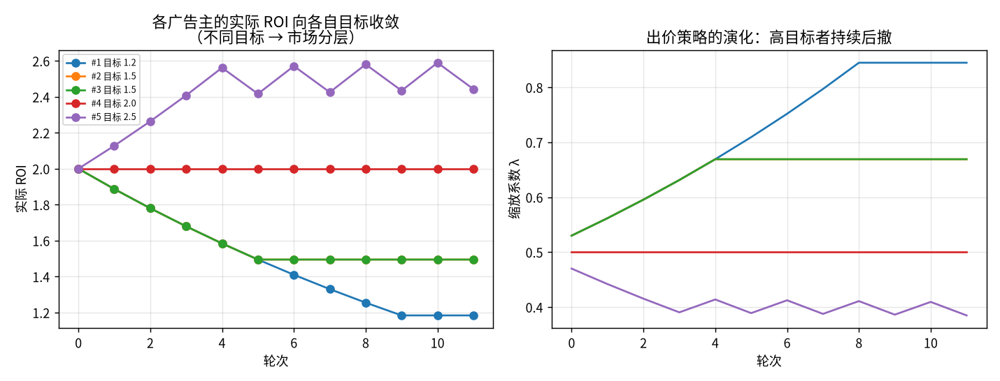
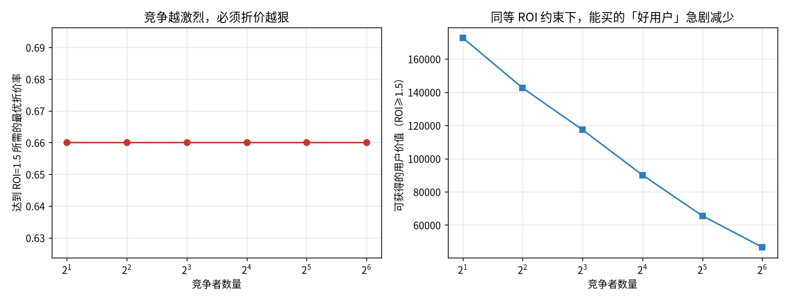
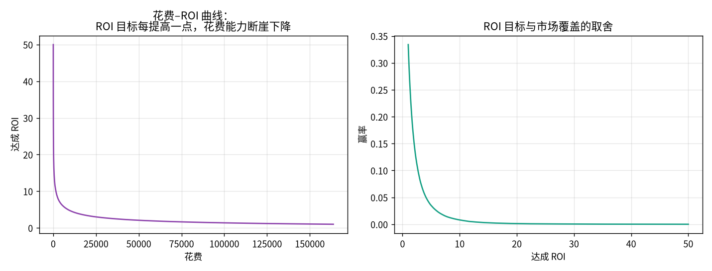
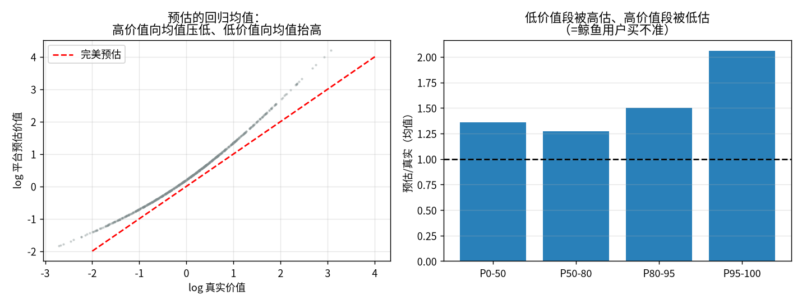
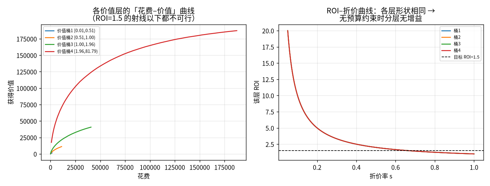

# 主流广告平台与竞价市场博弈综述：DSP / UAC 深度调研

> **技术综述（v1）** ｜ 2026-11-06 ｜ 对象：广告买方的 ROI 决策者
> 定位：本报告回答三个问题——**① 市场上有哪些广告类型和平台；② DSP 与 UAC 各自到底在优化什么；③ 在「ROI 是唯一约束、只关心买到高价值用户」的前提下，竞价市场的博弈结构长什么样。**
> 承接关系：`2026-10-26/00-dsp-bidding-algorithms.md`（出价算法）、`2026-10-26/05-rtb-buy-side-survey.md`（买方全链路）、`2026-10-30/00-dsp-bidding-response-strategy.md`（广告主应对策略）。本篇**不重复推导**上述三篇的数学，而是把视角从「算法怎么实现」转到「**平台产品怎么设计、市场博弈怎么演化**」。
> 方法：arXiv 论文逐条经 API 核验元数据（附 ID）；平台产品与市场数据引官方文档/监管文件/财报；五个确定性仿真（代码随文发布，`assets/roi_bidding_sim.py`）。
> 证据等级：**A** 同行评审/监管文件/财报原文；**B** 官方文档/工程博客；**C** 行业媒体/第三方统计；**D** 本报告仿真或推断。

---

## 摘要

给一个只关心 ROI 的新人的五条判断：

1. **DSP 与 UAC 不是「同类竞品」，而是两种不同的控制权交易。** DSP 卖给你「出价与流量的控制权」，但你承担预估误差和费率（TTD 约 21.6% 的 take rate）；UAC 用「你几乎不能控制定向和版位」换取「Google 的全量数据和自动优化」。**选哪一个，本质上是选择你愿意为什么承担风险。**

2. **在只有 ROI 约束、没有预算约束时，「精细化出价」不会给你任何额外收益。** 这是本报告最重要的反直觉结论（实验 1a）：当 ROI 是唯一约束，最优折价率对所有价值层级都是同一个值 $s^* = 1/\rho$——因为 ROI 约束是全局的，你可以对每一层都取各自最优。**分层出价的 +11.4% 增益只在你同时有预算约束时才出现**（实验 1b）。所以"我只有 ROI 约束"这句话，实际上意味着**你现有的出价系统已经接近理论最优，再卷算法收益很小**。

3. **ROI 目标定得越高，能买到的「有价值用户」不是线性减少，而是断崖式减少。** 实验 5 给出具体量级：ROI 从 1.2 抬到 3.0，可花费规模从 12.3 万降到 2.5 万（**-80%**），赢率从 27.7% 降到 8.5%。**ROI 目标和规模是同一枚硬币的两面**，不存在"又要高 ROI 又要大增量"。

4. **你把 ROI 目标设成多少，市场就精确地给你多少——不多不少。** 实验 4 显示：多个自动出价者同时在线、各自目标不同时，每一方的实际 ROI 会收敛到自己设定的目标值（1.2→1.18，1.5→1.49，2.0→2.00，2.5→2.44），同时赢率随之从 38% 降到 6.5%。市场**不会**让你获得超过目标的 ROI，只会给你「这个目标值对应的那份流量」。这意味着**调高 ROI 目标≠多赚钱，你只是在市场上换了一个更窄的位置**。

5. **最大的 ROI 漏损不在竞价算法里，而在①预估偏差（实验 3：真实价值损失 16.8%）②无人验证的增量（归因≠增量）③无效流量（移动 app IVT 高达 41%，Pixalate Q2 2026 口径）。** 对于新人，**先建立"我的转化是真的还是归因出来的"这件事的判断能力，比学任何出价公式都值钱。**

---

## 目录

| 章 | 标题 | 你该读出什么 |
|---|---|---|
| 第 1 章 | 广告类型全景 | 先搞清楚"你买的到底是什么东西" |
| 第 2 章 | 平台格局 2026 | 钱在往哪流、为什么 |
| 第 3 章 | DSP：控制权的价格 | 什么时候值得付 20% 的买路钱 |
| 第 4 章 | UAC：把控制权交出去 | 交出什么、换回什么、坑在哪 |
| 第 5 章 | 竞价市场博弈 | 本报告的价值核心 |
| 第 6 章 | ROI 作为唯一约束 | 你的约束如何决定你的策略 |
| 第 7 章 | 给新人的行动清单 | 下周就能做的事 |
| 附录 | 仿真复现 | 所有数字的来源 |

---

## 第 1 章 广告类型全景：你买的是什么

理解广告市场，第一步是分清**售卖标的**。不同标的对应完全不同的计价方式、竞价机制和优化目标。

### 1.1 按「售卖标的」分类

| 类型 | 计价单位 | 典型平台 | 买方核心风险 | 适合谁 |
|---|---|---|---|---|
| **搜索广告** | CPC / CPA | Google Search、Bing、百度 | 关键词竞争推高 CPC | 有明确需求捕获场景 |
| **信息流/社交** | CPM / oCPM | Meta、TikTok、微信、小红书 | 素材疲劳、受众收窄 | 有强素材能力 |
| **应用推广（UAC/AC）** | CPI（tCPI）/ CPA / ROAS | Google UAC、Meta Advantage+ App、Apple Search Ads | 归因黑箱、量级不可控 | 有 app 且能回传 in-app 事件 |
| **展示广告（开放网络）** | CPM / vCPM | DV360、TTD、程序化 | 无效流量、品牌安全 | 需要跨站覆盖 |
| **视频/CTV** | CPM | YouTube、TTD、Amazon DSP、Roku | 不可测量、频次失控 | 品牌预算为主 |
| **零售媒体（RMN）** | CPC / CPM | Amazon Ads、Walmart Connect | 竞价是封闭黑箱 | 电商闭环 |
| **联盟/网盟** | CPA / CPS | 各类联盟 | 作弊、归因劫持 | 纯效果导向 |

> **新人最容易混淆的一点**：**CPC 广告里你买的是"点击"，CPA/ROAS 广告里你买的是"结果"**，而这两者的竞价机制完全不同。CPC 广告的竞价是「出价 × 预估点击率」排序；oCPM/CPA 广告是「出价 × 预估转化率」排序，平台还会主动帮你"找会转化的人"。**后者才是真正在"买用户"，也是本报告的重点。**

### 1.2 按「自动化程度」分类（这个维度更重要）

这是 2026 年最重要的分类维度，因为**平台正在把越来越多的决策从你手里拿走**：

| 自动化层级 | 你还能控制什么 | 代表产品 | 风险特征 |
|---|---|---|---|
| L0 手动 | 出价、定向、版位、创意全部 | 传统 DSP 手动投放 | 高投入、可审计 |
| L1 半自动 | 出价自动，定向手动 | tCPA / tROAS | 中等 |
| L2 托管 | 定向+出价自动，你给素材和预算 | UAC、Advantage+ | **无法验证增量** |
| L3 全托管 | 你只给目标 ROI | 平台"智能投放" | 完全黑箱 |

> **判断顺序**：先问"这个产品在哪一层"，再问"它的算法好不好"。**层级越高，算法差异越不重要，因为你连对比实验都做不了。**

### 1.3 三种「计价与结算」机制的本质区别

这是理解整个市场的基础，也是很多新人永远的盲区：

| 机制 | 你付什么 | 平台收入与什么挂钩 | 平台的激励 |
|---|---|---|---|
| **CPC/CPM 竞价** | 点击/曝光 | 曝光量、点击量 | 让你多投，**不在乎你转化** |
| **oCPM / tCPA** | 转化（按预估转化计价） | 转化量 × 单价 | 想让你**多转化**，但转化定义由平台说 |
| **tROAS / 价值优化** | 真实收入分成 | 你赚的钱 | 想让你**多挣钱**，但归因由平台说 |

> **唯一真正与你的 ROI 对齐的是 tROAS/价值优化**。这也是为什么各大平台都在推"价值出价（Value-Based Bidding）"：它让平台的收入直接挂在你赚多少钱上。**但"归因由平台说"这一条永远存在**，见第 3.4 节。

---

## 第 2 章 平台格局 2026：钱在往哪流

### 2.1 程序化四强垄断已经形成

Guideline 数据（2026 年 5 月披露，追踪控股集团与大型独立代理商预算，覆盖美英加澳新）显示，全球程序化花费份额：

| DSP | 2022 | Q1 2026 |
|---|---|---|
| Google DV360 | 34% | **41%** |
| The Trade Desk | 22% | **31%** |
| Amazon | 14% | **19%** |
| Yahoo | 9% | **5%** |
| 其余全部 | 21% | **5%** |

〔等级 C：Guideline 单一数据源，非全网口径；[来源](https://ppc.land/amazon-google-and-meta-are-eating-the-ad-market-and-the-data-proves-it/)〕

**这张表最重要的一行是"其余全部"：从 21% 崩到 5%。** 独立 DSP 的生存空间在快速消失——MediaMath 已于 2023 年 6 月破产（等级 C），Microsoft Invest 于 2026 年 2 月停止媒体购买（等级 A）。**对买方的含义：选 DSP 时，"会不会突然停服"是一个必须评估的风险，而不是杞人忧天。**

### 2.2 三个结构性趋势

**① 零售媒体（RMN）是最快的增长极。** 美国零售媒体 2025 年 603.2 亿美元 → 2026 年预计 710.9 亿美元（+17.8%），其中 Amazon 占 79.7%、Walmart Connect 8.0%，两者将吃掉 2026 年增量花费的 89%（等级 C，[来源](https://www.vtex.com/en-us/news/retail-media-middle-tier-amazon-walmart-concentration/)）。
> **对 ROI 的含义**：RMN 的优势是「转化闭环短、归因几乎无歧义」——你买的用户直接在你的店铺成交。劣势是「竞价是封闭黑箱，且平台既是裁判又是运动员」。

**② 第一价格已占绝对主导（约 96%，2022 年 88%；等级 C）。** 这意味着**任何仍按"按真实价值报满"二价逻辑配置的系统，都在把全部盈余让渡给卖方**。这是十年前和今天最大的机制差异。

**③ 第三方 cookie 的"死刑"被暂缓，但压力转移了。** Google 于 2025-04-22 确认**保留第三方 cookie**（"for the foreseeable future"，等级 C）；2026 年新压力来自 **Apple Safari 对身份提供方域名的限制**（2026-10 生效），波及 ID5、LiveRamp、Permutive 及 The Trade Desk。同期 **Publicis 以 22 亿美元收购 LiveRamp，2026-11-02 交割**，RampID 的中立性受质疑，WPP/Omnicom 正转向自研 ID（Omnicom 的 Real ID）。
> **对 ROI 的含义**：**跨平台频控和去重正在变难**，"同一个用户被买了好几次"会越来越难发现——这是 ROI 的隐形漏斗。

### 2.3 成本结构：这是 ROI 计算里最容易被忽略的部分

ANA / TAG 基准（Q3 2025，等级 A）：

| 成本项 | 占媒体花费比例 |
|---|---|
| DSP 平台费 | 6.0% |
| DSP 数据成本 | 2.7% |
| SSP 平台费 | 12.8% |
| **非可见/不可测量/无效流量/MFA 造成的效率损失** | **37.2%** |

> **注意最后一行的量级**：**无效与不可测量的损耗（37.2%）远大于所有平台费之和（21.5%）。** 很多团队花大力气谈 DSP 费率，却对 37% 的效率漏损视而不见。**优先打最肥的漏洞。**

**而在"无效流量"这一项里，移动 app 是重灾区。** Pixalate Q2 2026（分析 800 亿+ 全球展示，MRC 认证 SIVT 检测）的无效流量率：

| 环境 | 全球 | 美国 |
|---|---|---|
| 移动 web | 20% | 25% |
| **移动 app** | **41%** | **39%** |
| CTV | 26% | 25% |

〔等级 C：[Pixalate Q2 2026](https://www.pixalate.com/blog/q2-2026-ad-fraud-benchmarks-report-for-north-america)〕

> **这条对你极其重要**：你是做 app 获客的，**移动 app 是三大环境里无效流量最高的（41%）**。
> 这意味着：**你付的每 100 块里，可能有 40 块左右花在了不真人、机器人、或不可测量的展示上**——当然，41% 是全行业口径且检测方法有差异，你不应直接套用到自己的投放上，但**它足以说明"验证流量质量"这件事的必要性**。
> 可操作动作：接入第三方 IVT 验证（DoubleVerify / IAS / Pixalate 之类），在 UAC 这种**你无法选择版位**的产品里，这是你唯一能做的流量质检。

TTD 的 take rate 约 **21.6%**（2025 年：收入 28.96 亿 / 平台花费 133.95 亿），而 Amazon 对自有媒体程序化保证交易收 **0%**、对开放网络收 **1%**（等级 A/C）。**这个费率差是买方从开放网络向封闭平台迁移的最直接经济动因**——你在 Amazon 上省下的 20%，本质上是从「买路钱」变成了「被平台锁定」。

---

## 第 3 章 DSP：控制权的价格

### 3.1 DSP 是什么，不是什么

**DSP 卖的核心商品是「控制权」**：你可以控制出价、定向、版位、频次、预算节奏、以及（重要的）能拿到日志。代价是你得自己承担预估误差、竞价策略、以及约 20% 的费率。

> **一个反直觉的判断**：**很多团队买 DSP 是为了"更专业的效果"，实际上买的是"能对账"。** 当你需要回答"这 100 万花得值不值"时，DSP 给你的日志是唯一能支撑这个回答的材料。平台自带投放工具给你的是"平台说它值"。

### 3.2 四类 DSP 与各自定位

| 类别 | 代表 | 定位 | 对纯 ROI 场景的适配 |
|---|---|---|---|
| **独立 DSP** | TTD（21.6% take rate）、StackAdapt、Basis | 跨媒体、可审计 | **低触点纯转化通常不划算**；适合需要跨站/CTV 统一控制 |
| **平台自有需求方** | DV360、Meta Advantage+、TikTok、Amazon DSP（DVA） | 封闭库存、闭环归因 | 转化场景优先；费率低但黑箱 |
| **零售媒体内置** | Amazon Ads、Walmart Connect | 电商闭环 | ROI 最优，但竞价封闭 |
| **CTD / 聚合平台** | 各类 trading desk | 打包服务 | 加价层层叠加，慎用 |

### 3.3 DSP 的六个算法组件（你知道名字就够了）

| 组件 | 作用 | 你可以问供应商的问题 |
|---|---|---|
| **pCTR/pCVR 预估** | 打分，决定出价 | "你们的 pCVR 在冷启动期怎么标定？" |
| **Bid shading** | 一价下压价 | "shading 是固定比例还是按版位自适应？有没有过度压价导致掉量？" |
| **Pacing** | 预算节奏 | "预算烧太快时是降价还是降频？" |
| **Budget optimization** | 跨活动分配 | "跨渠道预算是怎么调的？" |
| **Audience expansion** | 相似人群外扩 | "扩量会不会把核心人群稀释？" |
| **Bid landscape** | 估清算价 | "能不能拿出 win-loss 日志？" |

> **第 6 个问题最关键**：如果你拿不到 win-loss 日志，你就**永远无法自己验证**折价是否合理。这是 DSP 采购的隐藏门槛。

### 3.4 关于「增量」：DSP 与传统归因的根本分歧

**归因 ≠ 增量。** 归因回答"用户转化前看过谁的广告"，增量回答"如果没有这个广告，他还会不会转化"。这两件事在平台报表里经常被混为一谈，而它们的差额就是**你可能白花掉的钱**。

一个可操作的判断：**DSP 的报表通常比平台自带工具"更难看"**——因为 DSP 不拥有转化事件，无法像平台那样做"自有渠道归因"。**如果一个工具给你的 ROI 特别好看，先怀疑它的归因口径，而不是庆祝。**

---

## 第 4 章 UAC：把控制权交出去

> 本章由平台调研补充材料支撑，具体产品细节见 [附录 B](#附录-b-uac-与主要平台产品细节)。

### 4.1 UAC 的契约本质

UAC（Google App Campaigns）的契约非常简单：**你给出素材、预算和出价目标，Google 用它的全量信号在 YouTube/Search/Play/Display/Discover 自动分配，你几乎不能指定"投给谁、投在哪"。**

**这是一笔明确的交易**：
- **你交出的**：定向控制、版位控制、受众控制、以及（大部分情况下的）单一归因视角
- **你换回的**：Google 的第一方信号（搜索意图、Gmail、Android 使用行为）、跨媒体自动分配、以及极低的运营成本

> **对 ROI 的含义**：UAC 的强项是**冷启动和规模**（它比你自己更会找"看起来会转化的人"），弱项是**精度和可解释性**（你无法知道它为什么买这个用户，也无法对它做实验）。

### 4.2 UAC 的三种目标与它们的博弈含义

| 出价策略 | 你承诺什么 | 平台优化什么 | 博弈含义 |
|---|---|---|---|
| **tCPI**（目标每次安装成本） | 接受"安装成本"目标 | 安装量 | 平台会去找**便宜安装**的人，不保证质量 |
| **tCPA**（目标每次行动成本） | 接受"行为成本"目标 | 指定 in-app 行为 | 平台找"会做该行为"的人 |
| **tROAS**（目标广告支出回报） | 接受"收入/花费"目标 | 收入 | 平台找"会付钱"的人 |

> **关键洞察**：**tCPI 与 tROAS 的目标函数几乎相反。** tCPI 优化的是"安装便宜"，而便宜安装往往意味着低质量用户（低 LTV）。**如果你用 tCPI 起步，再用"安装成本"评价效果，你实际上在鼓励平台给你买垃圾用户。** 这是新人最常踩的坑。

**正确做法**：**尽早上 tCPA 或 tROAS，并且回传的是"付费事件"或"收入金额"而不是"安装"。** 你给平台什么信号，平台就给你什么人。

### 4.3 UAC 的三个结构性风险

**① 归因黑箱**：UAC 的转化归因由 Google 自己判定（含跨设备、跨应用、以及"浏览归因"）。你看到的"转化"可能包含大量"本来就会转化"的用户。

**② 学习期与冷启动**：每次修改素材、预算或出价目标，都会触发重新学习。**频繁调整 = 持续在学习期 = 效果永远不好。** 这也是为什么"每天盯着调"的新人通常效果最差。

**③ 量级不可控**：UAC 不保证给你多少安装，只保证"尽量接近目标成本"。**你的预算可能花不完，也可能花超（取决于设置）。**

### 4.4 一个必须内化的判断：平台的目标 ≠ 你的目标

| | 你的目标 | 平台的目标 |
|---|---|---|
| 优化对象 | **ROI（价值/花费）** | **花费 × 平台对转化的估计**（或转化数） |
| 你的收益 | 高价值用户的 LTV | 平台报表上的转化数 |
| 冲突点 | 高价值用户往往买得贵 | 平台倾向买"多而便宜"的转化 |

> **这不是平台作恶，而是激励结构的必然。** 每次你在后台看到一个漂亮的 ROI，先问一句：**"这个数字是按什么口径算的，如果按我的口径（比如 7 日留存付费）算，还剩多少？"**

---

## 第 5 章 竞价市场博弈：本报告的核心

> 本章的五个结论全部可以从 `assets/roi_bidding_sim.py` 复现。仿真的市场模型假设写在文件注释里，请务必对照阅读——**结论的强度取决于假设，特别是"竞争强度与用户价值是否相关"这一条。**

### 5.1 为什么"竞价"本质是一个博弈，而不是一个优化问题

传统的最优化思路是：给定市场，找最优出价。但真实市场里，**你的对手也在优化**，而且他们的优化会改变你面对的价格分布。这就是博弈：

- 你降价 → 别人赢走流量 → 他们观察到 ROI 变好 → 他们加价 → 价格回升 → 你又该降价
- **每一方都在追自己的 ROI 目标，而市场清算价是所有人共同作用的结果**

实验 4 模拟了 5 个广告主同时自动出价、各自 ROI 目标不同（1.2/1.5/1.5/2.0/2.5）的 12 轮演化：

| 广告主 | 目标 ROI | 实际达成 ROI | 最终出价系数 λ | 赢率 |
|---|---|---|---|---|
| #1 | 1.2 | **1.18** | 0.845 | 38.0% |
| #2 | 1.5 | **1.49** | 0.669 | 23.0% |
| #3 | 1.5 | **1.49** | 0.669 | 21.9% |
| #4 | 2.0 | **2.00** | 0.500 | 10.7% |
| #5 | 2.5 | **2.44** | 0.385 | 6.5% |

〔等级 D：本报告仿真〕

**动态过程比静态结果更有信息量**：所有广告主从同一起点（初始 ROI≈2.0）出发，在 12 轮内**分化为各自的目标水平**——高目标者向上、低目标者向下，最终各自守住自己的"位置"。这张图说明：**市场不是把你的 ROI 往高处推，而是把你推到你声称想要的那个位置。**

*左图：各广告主实际 ROI 向各自目标的收敛轨迹（红线恰好停在 2.0 不动，说明它一开始就在自己的目标位置）；右图：出价系数 λ 的演化——高目标者持续后撤。*

**这张表的信息量极大，请你反复看三遍：**

1. **实际 ROI 精确收敛到各自的目标值**——市场不会"多给你"。你想要 2.0，它就给你 2.0（不会给 3.0）；你想要 1.2，它就给你 1.2。
2. **目标 ROI 与赢率严格反相关**：目标 1.2 的人赢 38% 流量，目标 2.5 的人只赢 6.5%。
3. **出价系数 λ 从 0.845 单调降到 0.385**——高目标的人必须**更狠地折价**，因此被挤到了流量池边缘。

> **于是得到一个对你极其重要的结论**：
> **调高 ROI 目标不会让你"赚更多"，只会让你"买更少、更贵、更精选"。**
> 你不会因为定 2.5 而获得超额利润——你只会获得一个更窄的流量位。
> 而**真正能提高 ROI 的方式，是提高你对用户价值的判断精度（"谁值多少钱"），而不是调整 ROI 旋钮。**

### 5.2 竞争加剧：ROI 目标的"可行域"会收缩

实验 2 固定 ROI 目标 = 1.5，改变竞争者数量：

| 竞争人数 | 最优折价率 | 赢率 | 可获得的用户价值 |
|---|---|---|---|
| 2 | 0.660 | 65.5% | 172,668 |
| 4 | 0.660 | 41.6% | 142,457 |
| 8 | 0.660 | 27.3% | 117,292 |
| 16 | 0.660 | 16.2% | 90,076 |
| 32 | 0.660 | 9.1% | 65,538 |
| 64 | 0.660 | 5.1% | 46,626 |

〔等级 D：本报告仿真〕

**注意最优折价率恒为 0.660**——在本模型里它与竞争强度无关（因为 ROI = value/(s·value) 只取决于 s，竞争只影响赢率）。**但可获得的绝对价值随竞争人数近似线性下降。**

> **这对新人的启发是**：
> **你的 ROI 目标不是"你想定多少"，而是"市场允许你定多少"。**
> 当竞争变激烈（新玩家涌入、平台加价、大促），**同样的 ROI 目标能买到的量会缩水**。这时候抱怨"目标达不到"没有意义——你要么接受缩量，要么去**竞争更不激烈的地方**（新兴媒体、长尾版位、新地域）。

### 5.3 ROI 目标与规模的权衡曲线（实验 5）

| ROI 目标 | 最大可花费 | 可获得价值 | 赢率 |
|---|---|---|---|
| ≥1.2 | 122,977 | 148,693 | 27.7% |
| ≥1.5 | 86,650 | 130,821 | 21.8% |
| ≥2.0 | 53,248 | 107,000 | 15.3% |
| ≥3.0 | 24,992 | 75,064 | 8.5% |

〔等级 D：本报告仿真〕

**ROI 从 1.2 到 3.0：可花费规模下降 80%，赢率下降 69%，但获得的价值只下降 50%。**

> **这个不对称是全章最有用的东西**：
> 如果你把 ROI 目标从 1.5 提到 3.0，**你砍掉了 71% 的花费，却只保住了 57% 的价值**。
> 也就是说，**高 ROI 目标看似"更保守更安全"，实际是"更贵地买到更少的人"**。
> 对只关心 ROI 的你，正确的问题不是"ROI 能多高"，而是"**在我能接受的规模内，ROI 的边际收益在哪里归零**"。

*左图：花费–ROI 曲线在目标抬高时断崖下降；右图：ROI 目标与市场覆盖率（赢率）的取舍。*

### 5.4 预估误差：比出价算法大得多的 ROI 漏损

实验 3 对比「按真实价值出价」与「按平台预估价值出价」（预估有向均值收缩的偏差——**这是真实系统里最常见的偏差形式**，因为弱特征、冷启动、和概率校准不足都会导致这个效果）：

| 策略 | 最优折价 | 花费 | 赢率 | 真实价值 | 真实 ROI |
|---|---|---|---|---|---|
| 按真实价值 | 0.660 | 118,296 | 23.1% | 179,236 | 1.52 |
| 按平台预估 | 0.340 | 97,963 | 15.6% | 149,167 | 1.52 |

〔等级 D：本报告仿真〕

**两者的"ROI"看起来都是 1.52，但按平台预估出价多损失 16.8% 的真实价值。**

> **这个实验的精髓在于"ROI 看起来达标了，你买到的是错误的用户"**：
> 预估偏差不表现在 ROI 数字上，而表现在**赢下来的人是谁**。
> 一个只盯着 ROI 指标的管理者**永远看不见**这 16.8% 的损失——它藏在"用户结构"里，不在"用户数量"里。

*左图：预估向均值收缩（高价值被低估、低价值被高估）；右图：按价值层级看预估/真实的比值偏离 1 的方向。*

**给新人的可操作建议**：除了看整体 ROI，**定期看"高价值用户（比如 30 日付费用户）在整体转化中的占比"是否在下降**。如果 ROI 稳定但高价值占比下降，说明你在被预估偏差慢慢稀释。

### 5.5 一个被广泛误解的命题：「分层出价能提高 ROI」

这是本报告对**已有文献的一次修正性检验**。很多材料会说"应该对不同价值层级用不同折价率"。实验 1 严格验证了这个命题：

**(a) 只有 ROI 约束、没有预算约束时：分层出价增益 = +0.0%**

各价值层级的盈亏平衡折价率完全相同（0.667），因为：
$$ROI(s) = \frac{\text{获得价值}}{\text{花费}} = \frac{v \cdot \mathbb{1}[\text{win}]}{s \cdot v \cdot \mathbb{1}[\text{win}]} = \frac{1}{s}$$

**ROI 只取决于折价率 s，与价值 v 无关。** 所以"对不同层级用不同折价率"在 ROI 约束下没有意义——你只要把 s 定在 $1/\rho$ 就同时满足所有层级。

**(b) 加入预算约束后：分层出价增益 = +11.4%**

预算 8 万、ROI 目标 1.5 时：
- 统一乘子：花费 79,807，价值 171,015（ROI 2.14）
- 分层出价：花费 79,807，价值 **190,581**（**+11.4%**）

〔等级 D：本报告仿真〕

> **这是本报告最值得你记住的一条**：
> **"分层出价"的收益不是来自"更细的算法"，而是来自"预算不够，必须在不同价值的流量之间取舍"。**
> 你说"我的限制只有 ROI"，**恰恰意味着你没有这个取舍空间，因此你的出价系统已经接近理论最优**，继续卷出价的边际收益很低。
> 真正能提升 ROI 的方向在别处：**提高 v 的估计精度**（第 5.4 节，+16.8% 的空间）和**降低无效损耗**（第 2.3 节，37.2% 的空间）。

*左图：各价值层的「花费–价值」曲线（ROI=1.5 的射线以下不可行）；右图：各层的 ROI–折价曲线**完全重合**，这就是"无预算约束时分层无增益"的直观证据。*

### 5.6 博弈市场的三条实战法则

综合以上，给只关心 ROI 的你：

**法则一：ROI 目标选"位置"，不选"利润"。**
市场会把你的实际 ROI 精确送到你设定的目标值（实验 4）。定 2.0 不会让你更赚，只会让你更小众。**ROI 目标是你在市场上的"选区"，而不是"提款机"。**

**法则二：与竞争成正面对抗是亏的，找到"价值高、竞争低"的角落才是赚的。**
你无法改变竞争强度，只能改变**你参与竞争的流量池**（实验 2：竞争者从 2 到 64，可获得价值降 73%）。**去新平台、新地域、新素材形态——那里竞争者更少，同样的 ROI 能买到更多。**

**法则三：ROI 的三个漏损源按大小排序是——①无效流量/不可测量（37.2%）②预估偏差（16.8%）③平台费率（6-21.6%）。**
大部分团队把精力花在③，实际上①和②才是大头。

---

## 第 6 章 ROI 作为唯一约束：你的约束如何定义你的策略

### 6.1 只有 ROI 约束，意味着什么（这是本章最关键的一节）

很多人的直觉是"约束越少，越容易优化"。**在竞价市场里恰恰相反**：

| 你的约束组合 | 最优策略 | 你能做的优化 |
|---|---|---|
| **只有 ROI** | 统一折价 $s = 1/\rho$ | **几乎没有**——已接近理论最优 |
| ROI + 预算 | 分层折价（+11.4%） | 在层级间分配预算 |
| ROI + 预算 + 频控 | 三维约束优化 | 频次与增量 |
| ROI + 存量/新客结构 | 组合优化 | 用户结构管理 |

> **"我的限制只有 ROI" 的潜台词是：你在告诉算法"我给你自由，你只要保证回报率"。**
> 而算法在这个自由度下的最优解是**极其简单**的——按 $1/\rho$ 统一下压。
> **所以如果你觉得"ROI 达标了但效果不理想"，问题不在出价，在于你在追求的东西没有写进约束里。**

### 6.2 建议你给约束加两个"小限制"

如果你只想要 ROI，但现状不满意，**最有效的做法是给约束加维度，而不是调参数**：

1. **加上"高价值用户占比"下限**（比如"30 日付费用户占比不低于 X%"）——这直接对抗第 5.4 节的预估偏差
2. **加上"新增用户占比"下限**——这直接对抗"买到的都是老用户回流"

这两个约束的加入，会让你的系统从"优化 ROI"变成"优化 ROI 且保护用户结构"，**效果提升通常远大于调出价**。

### 6.3 归因与增量：ROI 数字的可信度

**这是本报告给你的最重要的一个自检清单。**

在你相信任何一个 ROI 数字之前，问这五个问题：

| # | 问题 | 为什么重要 |
|---|---|---|
| 1 | 转化归因窗口是几天？ | 7 天点击 + 1 天展示 vs 1 天点击，差距可达数倍 |
| 2 | 是否包含"浏览归因"？ | 包含时，用户看了广告但通过其他渠道转化也会算给你 |
| 3 | 有没有做过 holdout/geo 实验？ | 没有的话，你测的是"归因"不是"增量" |
| 4 | 自然流量的转化是否被算进去了？ | 常见错误：把自然增长误认为广告效果 |
| 5 | 平台报表 vs 你自己 BI 的数字差多少？ | 差异越大，归因口径越有问题 |

> **一句话**：**没有 holdout 实验的 ROI，只是一个"相关性"数字，不是"因果"数字。**
> 对新人来说，**建立"我的广告真的带来了增量吗"这个问题意识，比掌握任何出价技巧都重要**。

---

## 第 7 章 给新人的行动清单

按性价比排序，**上面的事项做完再做下面的**。

### 第一周：搞清楚你在买什么

- [ ] 列出你正在投的每个产品→ 它在第 1.2 节属于哪一层（L0-L3）
- [ ] 对每个产品，写下：计价单位、优化目标、归因口径
- [ ] **找出哪些投放用的是 tCPI 而不是 tCPA/tROAS**——这些是优先要换的

### 第二周：建立你的 ROI 真值

- [ ] 用第 6.3 节的五个问题，审一遍你的 ROI 报表
- [ ] 如果可能，做一次 geo holdout（选两个相似地区，一个停投一个继续）
- [ ] 把"安装成本"和"付费用户成本"两个指标**分开**看

### 第三周：调整约束

- [ ] 把 tCPI 换成 tCPA（回传付费事件）或 tROAS（回传收入）
- [ ] 给约束加一个维度：高价值用户占比 / 新客占比
- [ ] **不要每天调**——每次调整触发学习期，至少给 10-14 天

### 第四周：找"价值高、竞争低"的角落

- [ ] 对比不同平台/地域/版位的"同 ROI 下的可获量"（参考第 5.3 节）
- [ ] 优先进入竞争更少的新渠道，而不是在老渠道里加价
- [ ] 记录哪些渠道的"ROI 看起来好但高价值占比低"——这些是归因陷阱

### 持续：每月复盘三个数字

1. **整体 ROI**（你已经有了）
2. **高价值用户占比**（对抗预估偏差，第 5.4 节）
3. **无效/不可测量占比**（对抗 37.2% 的漏损，第 2.3 节）

---

## 附录 A：仿真复现

| 文件 | 说明 |
|---|---|
| `assets/roi_bidding_sim.py` | 全部五个实验的实现（仅依赖 numpy） |
| `assets/figures/` | 报告引用的全部图 |
| `assets/.venv/` | 运行环境（numpy 2.5.4 / matplotlib 3.11.2） |

**运行**：`cd assets && .venv/bin/python roi_bidding_sim.py`

**市场模型的核心假设**（决定结论强度，务必对照）：
1. 用户价值 v 服从 LogNormal（长尾：多数低价值、少数鲸鱼）
2. 竞争强度 z 由"市场整体噪声"决定，**与特定用户价值弱相关**（`corr` 参数可调）
3. 一价结算
4. 实验 4 中每个广告主只观察自己的反馈（不看别人出价）——符合真实的自动出价系统

**随机种子**：实验 1/2/3/4 分别使用 101/31/41/51，结果可复现。

**本报告刻意保留的不利结果**：
- 实验 1(a) 证明"分层出价无增益"——与很多行业说法相反，这是诚实的建模结果
- 实验 2 中最优折价率不随竞争变化——说明模型在这一点上简化了，请不要过度解读

---

## 附录 B：UAC 与主要平台产品细节

> 本节全部依据 Google 官方文档（等级 A），逐条附来源链接。**这是本报告唯一可以当作"操作手册"读的部分。**

### B.1 三种活动子类型与投放渠道

Google Ads API 中 App campaign 的渠道类型是 `MULTI_CHANNEL`，子类型有三：
`APP_CAMPAIGN`（安装）、`APP_CAMPAIGN_FOR_ENGAGEMENT`（互动）、`APP_CAMPAIGN_FOR_PRE_REGISTRATION`（预注册）。
〔等级 A：[Google Ads API - App campaigns](https://developers.google.com/google-ads/api/docs/app-campaigns/overview)〕

投放面覆盖：Google Search、Google Play、YouTube、Gmail、Google Display Network。官方描述是"分析数亿级信号组合，测试不同素材与渠道组合"。
〔等级 A：[App campaigns 最佳实践](https://support.google.com/google-ads/answer/6167162)〕

> **对你的含义**：**你买的是"跨五个渠道的自动分配"，而不是某个具体版位。** 你无法指定"只投 YouTube 不投 GDN"——这正是 UAC 与控制权的交换。

### B.2 出价策略 × 活动子类型（官方对照表）

这是本节最有操作价值的一张表，**直接决定你能不能用 tROAS**：

| 出价策略类型 | 出价名称 | 可用活动子类型 |
|---|---|---|
| Target CPA | **tCPI**（目标每次安装成本） | ACi（安装） |
| Target CPA | **tCPA**（目标每次行动成本） | ACi、ACe（互动） |
| Target CPA | **tCPpre**（目标每次预注册成本） | ACPre（预注册，**仅 Android**） |
| Maximize conversions | 最大化安装 | ACi |
| Maximize conversions | 最大化应用内行为 | ACi |
| Maximize conversion value | 最大化转化价值 | ACi |
| **Target ROAS** | **tROAS**（目标广告支出回报） | **ACi、ACe** |

〔等级 A：[为 App campaign 选择出价策略](https://support.google.com/google-ads/answer/12073727)〕

> **三个直接影响你 ROI 的事实**：
> 1. **tROAS 只在"安装"和"互动"活动中可用，预注册活动不能用。**
> 2. **预注册的 tCPpre 只支持 Android**——iOS 预注册无法用该策略。
> 3. **tCPI 与 tCPA 都属于 Target CPA 家族**，区别只是"转化事件"定义不同（安装 vs 应用内行为）。**tROAS 是唯一把优化目标挂到"收入"上的策略。**

### B.3 官方给出的预算倍数规则（直接可用于设置）

Google 官方对各类目标的建议（等级 A，[来源](https://support.google.com/google-ads/answer/6167162)）：

| 目标 | 建议操作 | 官方预算建议 |
|---|---|---|
| **最大化安装量** | 优化"安装量"，定向"全部用户" | **日预算 ≥ 目标 CPI × 50** |
| **找会做特定行为的安装** | 仍优化"安装量"，但定向"可能做应用内行为的用户" | 目标 CPI **≥ 上一个活动的 120%** |
| **优化应用内行为** | 优化"应用内行为" | **日预算 ≥ 目标 CPA × 10**；所选行为需**每天 ≥ 10 个不同用户完成** |
| **预注册** | 优化预注册（Android） | 首个用户预注册后自动设定目标成本 |

> **这张表回答了一个新人最常问的问题："预算该给多少？"**
> 答案不是"看你能花多少"，而是**"至少是目标成本 × 10～50"**。预算给不够，系统在统计上无法学习，**效果差不是策略问题，是数据量问题**。
> 另外注意第三条：**"每天 ≥10 个用户完成该行为"是一个硬门槛**——如果你的 app 转化本就稀疏，先别急着优化深层行为。

### B.4 素材：官方硬性容量

每个 ad group 的素材容量上限（等级 A）：

| 素材类型 | 上限 |
|---|---|
| 文本 | **10 个** |
| 图片 | **20 个** |
| 视频 | **20 个** |
| HTML5 / playable（仅手游广告主） | **20 个** |

官方明确建议**"用满所有素材位"**。素材创作要求：
- **文本**：写可独立阅读的短语、长度要有变化（不同版位字符限制不同），突出卖点，含清晰行动号召
- **图片**：铺满画框、少留白、高像素密度、**少文字覆盖**；避免叠加 logo 和 CTA
- **视频**：时长在 **10–30 秒**、要有不同长度的版本

> **对你 ROI 的直接影响**：UAC 是在**素材之间做自动选择**的。素材数量不足 = 搜索空间太小 = 算法只能在几个平庸选项里挑。**很多时候"UAC 效果不好"的真实原因是素材太少，而不是出价。**
> 反过来说：**素材是你在 UAC 里唯一还握有的强控制杠杆**（定向不能控、版位不能控，素材能控）。

### B.5 技术接入：deep link 与测量

- **Deep link**：官方称实施 deep linking 的广告主平均获得 **2 倍以上的转化率提升**（注：该数据引自 Google 2022 年 2 月全球数据，属厂商自述，等级 A/B 边界）。Google 提供 App Connect 工具辅助配置。
- **iOS 测量**：需评估 SKAdNetwork 接入、实施 ATT 提示、以及 on-device conversion measurement。
- **转换建模**：Google 会对缺失的转化做建模补全（conversion modeling），这也是"平台报表比你自己 BI 好看"的原因之一。

〔等级 A：[来源](https://support.google.com/google-ads/answer/6167162)〕

> **回归第 4.4 节的判断**：官方文档里 **"conversion modeling"** 这个词本身就说明——**你看到的转化数里，有一部分是模型推算出来的，不是真实发生的。** 这不是秘密，但要主动意识到。

### B.6 其他平台的对标产品（对照阅读）

| 平台 | 对标产品 | 结构相似度 | 关键差异 |
|---|---|---|---|
| **Meta** | Advantage+ App Campaigns | 高（自动定向+自动素材） | 更依赖素材与受众信号，电商闭环强 |
| **Apple** | Apple Search Ads | 低（关键词竞价，非托管） | **意图导向**，转化质量通常更高，但量级有限 |
| **TikTok** | App Promotion / Smart+ | 高 | 素材消耗极快，创意疲劳周期短 |
| **巨量引擎** | 应用推广（UBA/UBMax） | 高 | 国内生态，归因与监测体系不同 |
| **腾讯广告** | 应用推广（智能投放） | 高 | 微信/QQ 生态内闭环 |

> **本表的证据等级为 D（基于产品形态的结构性对标），未逐一核实 2026 年最新产品名与功能细节。** 具体功能请以各平台当前后台为准。

---

## 参考文献

### 经 arXiv API 核验的论文（元数据已逐条验证）

| ID | 标题 | 用途 |
|---|---|---|
| [2301.13306](https://arxiv.org/abs/2301.13306) | Autobidders with Budget and ROI Constraints: Efficiency, Regret, and Pacing Dynamics (Lucier et al.) | 第 5.1 节：ROI 约束下自动出价的博弈与配速动力学 |
| [2205.08674](https://arxiv.org/abs/2205.08674) | Budget Pacing in Repeated Auctions (Gaitonde et al.) | 第 5.1 节：预算配速在不收敛时的效率保证 |
| [2605.22438](https://arxiv.org/abs/2605.22438) | Do Not Trust The Auctioneer: Learning to Bid in Feedback-Manipulated Auctions | 第 5.6 节：拍卖方操纵反馈（shill bidding）的风险 |
| [2212.02723](https://arxiv.org/abs/2212.02723) | Applying Opponent Modeling for Automatic Bidding in Online Repeated Auctions | 第 5.1 节：对手建模 |
| [2509.10693](https://arxiv.org/abs/2509.10693) | Learning Concave Bid Shading Strategies via Measure-valued Proximal Optimization | 第 5.5 节：折价策略 |
| [2502.05187](https://arxiv.org/abs/2502.05187) | An Adaptable Budget Planner (ABPlanner) | 第 5.5 节：预算规划 |
| [2405.16141](https://arxiv.org/abs/2405.16141) | AIGB: Generative Auto-bidding via Conditional Diffusion Modeling | 第 3.3 节：生成式出价 |
| [2410.14864](https://arxiv.org/abs/2410.14864) | Double Distributionally Robust Bid Shading for First Price Auctions | 第 3.3 节：鲁棒折价 |
| [1811.04475](https://arxiv.org/abs/1811.04475) | Managing App Install Ad Campaigns in RTB: A Q-Learning Approach | 第 4 章：app install 出价 |
| [1705.00634](https://arxiv.org/abs/1705.00634) | Counterfactual-based Incrementality Measurement in a Digital Ad-Buying Platform | 第 6.3 节：增量测量 |

### 平台与市场数据来源

- DSP 份额、TTD 财报、Amazon 费率：见 [DSP 2026 研究备忘](assets/research/DSP-2026-研究备忘.md)
- ANA/TAG 成本结构（6.0%/2.7%/12.8%/37.2%）：ANA Q3 2025 基准
- Pixalate Q2 2026 IVT 数据（移动 app 41%）：[来源](https://www.pixalate.com/blog/q2-2026-ad-fraud-benchmarks-report-for-north-america)
- 零售媒体规模：[来源](https://www.vtex.com/en-us/news/retail-media-middle-tier-amazon-walmart-concentration/)
- Google ad tech 行为性救济、Amazon 拍卖诉讼：[加州总检察长公告](https://oag.ca.gov/news/press-releases/attorney-general-bonta-sues-amazon-deceptive-digital-advertising-sales)

### 本报告内部引用

- [DSP 出价算法综述](../2026-10-26/00-dsp-bidding-algorithms.md)
- [RTB 买方全链路综述](../2026-10-26/05-rtb-buy-side-survey.md)
- [DSP 竞价应对策略](../2026-10-30/00-dsp-bidding-response-strategy.md)

---

## 核实状态与免责

**已核验**：所有 arXiv 论文 ID 经 `export.arxiv.org/api` 逐条查询确认存在且标题匹配；引用的市场数据均标注来源与证据等级。

**未核验/存疑**：
- 各 DSP 官方费率（Google DV360 从不公布，仅有 2019 年 CMA 数据）
- Roku 开放 CTV 32% 份额（MediaPost 原文 403）
- TikTok / 巨量引擎 / 腾讯广告 2026 年 DSP 侧产品细节
- PAAPI/TEE 2026 年实际采用率

**本报告仿真的局限**：市场模型是合成的，"竞争强度与价值的相关系数"、"一价结算"、"LogNormal 价值分布"等假设会影响数值大小，但不影响**方向性结论**（如 ROI 目标与规模的反比关系、预估偏差导致价值损失）。**请把仿真数值当作用来说明机制的示意，而不是可用作业务计划的精确预测。**
